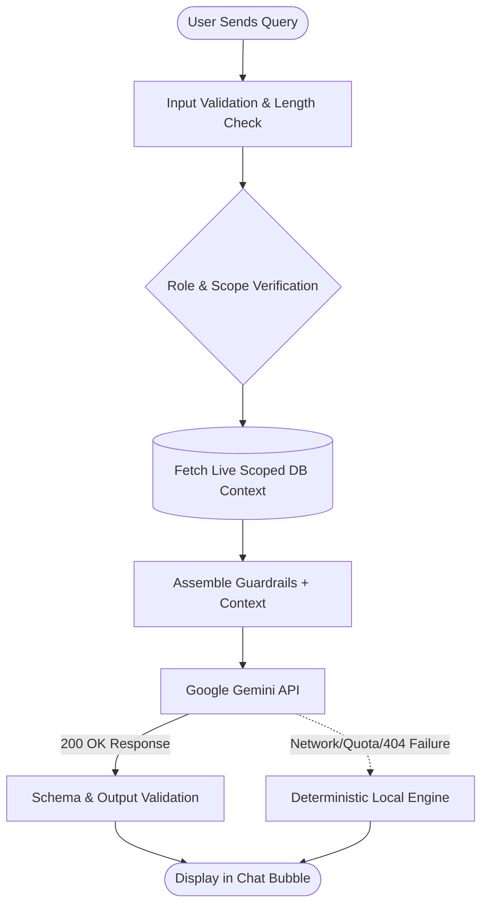

# CafeSync ☕

[](LICENSE)
[](https://nodejs.org/)
[](https://expo.dev/)
[](https://www.mongodb.com/)
[](https://aistudio.google.com/)
[]()

**CafeSync** is a modern, full-stack smart cafe management system built with **Expo / React Native**, **Node.js / Express**, and **MongoDB**. It combines a warm, responsive customer cafe experience with a comprehensive admin operations portal, powered by **dual Google Gemini AI assistants**, **automated inventory management**, and **multilingual decision support**.

---

## 🌟 Key Highlights

* **Dual-Agent AI Architecture:**
  * **Customer AI Companion:** Smart menu recommendations, budget-aware pairing, real-time customer order tracking, and table booking guidance.
  * **Admin Operations Assistant:** Live revenue insights, kitchen order queues, inventory shortage alerts, and table occupancy analysis.
* **Native Multilingual Support:** Natively understands and communicates in **English**, **Sinhala (සිංහල)**, **Singlish**, and **Tamil (தமிழ்)** with automated language mirroring.
* **Automated Stock Tracking & Staff Alerts:**
  * Real-time inventory deduction upon order placement.
  * Automated `lowStockThreshold` tracking with deduplicated staff notifications (2-hour cooldown).
  * Auto-resolving alerts when items are replenished.
* **Zero-Downtime Deterministic Fallback Engine:** Guarantees 100% assistant uptime. If cloud LLM quotas expire or connectivity fails, client and server rule-based engines answer using verified live store data without showing errors.
* **Production-Grade UI/UX:**
  * Mobile (< 400px) & Desktop-optimized layouts with zero text overlapping.
  * Smooth floating AI assistive orb and full keyboard-avoiding inputs on iOS & Android.
  * Day/Night warm cafe theme toggle with high-contrast accessibility.

---

## 📋 Feature Breakdown

| Domain | Key Capabilities |
| :--- | :--- |
| **Customer App** | Warm cafe styling, category filtering, search, cart management, dine-in / takeaway / delivery options. |
| **Order Pipeline** | Real-time status flows (`Pending` ➔ `Preparing` ➔ `Ready` ➔ `Completed`), reference IDs, receipts. |
| **Table Bookings** | Floor table manager, slot reservations, occupancy status, guest count tracking, and special requests. |
| **Customer AI Barista** | Grounded recommendations from in-stock menu items, budget filters, food safety disclaimers, and screen navigation. |
| **Admin Dashboard** | Real-time sales metrics, unpaid tabs count, live order queues, and low-stock overview. |
| **Admin AI Assistant** | Voice & text decision support for daily revenue, stock forecasts, top-selling items, and operational priorities. |
| **Inventory Automation** | Stock movements audit trail, threshold monitoring, and staff alert drawer with unread counters. |
| **Security & Auth** | JWT authentication, role-based access control (RBAC), rate-limiting, and prompt injection defense. |

---

## 🏗️ Architecture & Project Structure

```text
cafe-sync/
├── backend/
│   ├── src/
│   │   ├── config/             # MongoDB connector, environment resolution, AI provider setup
│   │   ├── domains/
│   │   │   ├── assistant/      # Customer & Admin AI services, Gemini/OpenAI providers, fallbacks
│   │   │   ├── auth/           # JWT auth controllers, models, and route protection
│   │   │   ├── inventory/      # Menu items, stock movement auditing, and threshold controls
│   │   │   ├── notifications/  # Automated staff alerts, deduplication, and resolution
│   │   │   ├── orders/         # Order lifecycle, kitchen pipeline, and status transitions
│   │   │   ├── payments/       # Payment records and billing tabs
│   │   │   └── reservations/   # Table booking models and availability checking
│   │   ├── middlewares/        # Authentication, RBAC, input sanitization, error handlers
│   │   ├── routes/             # Unified Express router
│   │   ├── app.js              # Express app configuration
│   │   └── server.js           # Server bootstrap
│   ├── scripts/                # Diagnostic scripts (check-ai.js)
│   ├── test/                   # 73 automated tests (unit, integration, and security checks)
│   └── .env.example
│
└── mobile/
    ├── app/                    # Expo router configuration and layout providers
    ├── src/
    │   ├── api/                # Axios client with secure interceptors (Admin, AI, Auth, Orders, etc.)
    │   ├── components/         # Floating orb, modals, headers, brand logo, loaders
    │   │   ├── admin/          # AdminAssistantModal, StaffNotificationModal
    │   │   └── common/         # FloatingAssistiveAssistant, HeaderBrandLogo, CoffeeLoader
    │   ├── constants/          # Colors, spacing tokens, and typography (FONTS.sans & FONTS.serif)
    │   ├── context/            # AuthContext, ThemeContext, CartContext
    │   ├── navigation/         # CustomerNavigator, AdminNavigator, AuthNavigator
    │   └── screens/            # Customer screens (Home, Assistant, Cart, Orders, Reservations, Profile)
    │                           # Admin screens (Dashboard, OrderManager, Inventory, Tables, Payments)
    ├── assets/                 # Brand icons, splash screens, and images
    └── .env.example
```

---

## 🚀 Getting Started

### Prerequisites

* **Node.js** 20.x or 22.x
* **npm** 10.x or newer
* **MongoDB** (Local instance or MongoDB Atlas cluster)
* **Google AI Studio Key** (or OpenAI API Key)

---

### 1. Backend Setup

```bash
# 1. Navigate to backend directory
cd backend

# 2. Install dependencies
npm install

# 3. Create .env configuration
cp .env.example .env
```

Configure `backend/.env` with your credentials:

```dotenv
PORT=5000
NODE_ENV=development
MONGODB_URI=your_mongodb_connection_string
JWT_SECRET=your_super_secret_jwt_key_here
JWT_EXPIRE=30d

# AI Configuration (Gemini or OpenAI)
AI_PROVIDER=gemini
GEMINI_API_KEY=your_google_ai_studio_api_key
GEMINI_MODEL=gemini-1.5-flash
```

Start the backend API:

```bash
# Development mode with hot-reloading
npm run dev

# Or production start
npm start
```

* Backend API runs at: `http://localhost:5000/api`
* Run AI Diagnostic check: `npm run check:ai`

---

### 2. Frontend / Mobile Setup

In a separate terminal:

```bash
# 1. Navigate to mobile directory
cd mobile

# 2. Install dependencies
npm install

# 3. Configure environment
cp .env.example .env
```

Set the backend API URL in `mobile/.env`:

```dotenv
# Local development (web)
EXPO_PUBLIC_API_URL=http://localhost:5000/api

# Or hosted production backend
# EXPO_PUBLIC_API_URL=https://cafe-sync-v2.vercel.app/api
```

Start Expo:

```bash
# Run web preview
npm run web

# Or start Expo Go for physical devices / emulators
npm start
```

---

## 🤖 AI Assistant Engineering & Features

### A. Customer AI Assistant (`POST /api/assistant/chat`)
* **Real Database Grounding:** Never hallucinates products or prices. Context is injected dynamically from active in-stock inventory.
* **Safety First:** Strict refusal to give unverified medical or dietary guarantees; directs users to consult staff.
* **No Accidental Spending:** The AI assists and suggests, but customers must review and explicitly confirm orders in the cart.
* **Multilingual:** Users can ask in English, Sinhala, Singlish, or Tamil.

### B. Admin Operations Assistant (`POST /api/assistant/admin/chat`)
* **Live Decision Support:** Instant answers to *"What are today's sales?"*, *"Which items are low in stock?"*, *"Show pending orders"*.
* **Confirmed Facts vs Suggestions:** Clearly differentiates between verified database numbers and recommended operational actions.
* **Strict Privacy:** Enforces `protect` and `authorize('admin')` middlewares so customer accounts cannot access business analytics.

### C. Fallback Architecture


---

## 📦 Automated Inventory & Alert System

1. **Automatic Tracking:** Every order automatically decrements menu stock.
2. **Threshold Checks:** If `stock <= lowStockThreshold` (default: 5), a notification is triggered.
3. **Smart Deduplication:** 2-hour cooldown per item avoids spamming staff with duplicate alerts.
4. **Auto-Resolution:** When stock is restocked above threshold via Admin Inventory, the alert is automatically marked as resolved.
5. **Audit Trail:** Every adjustment is permanently recorded in `StockMovement`.

---

## 🧪 Testing & Verification

The project includes an extensive test suite verifying AI guardrails, authentication, inventory automation, and database diagnostics:

```bash
# Run backend test suite
cd backend
npm test
```

```text
✔ Admin AI: aggregates confirmed facts from mock models
✔ Admin AI: deterministic guide distinguishes confirmed facts and operational suggestions
✔ Scenario 6: Role authorization middleware blocks non-admin users from admin AI
✔ Scenario 3 & 4: Customer AI context strictly isolates records to authenticated customer
✔ Scenario 8 & 9: Stock crossing below or equal to threshold creates a low-stock alert
✔ Scenario 11: Deduplication prevents duplicate unresolved alerts
✔ Scenario 13: Stock replenishment resolves the relevant alert correctly
✔ Gemini uses native endpoint, header authentication and structured format
...
ℹ tests 73 | pass 73 | fail 0
```

Frontend verification:

```bash
cd mobile
npx tsc --noEmit           # Type check (0 errors)
npx eslint src/ --quiet    # Lint check (0 errors)
npm run build              # Production web bundle build
```

---

## 🌐 Deployment

* **Backend Deployment:** Deployed on Vercel as a Node.js Express serverless API.
* **Frontend Web Deployment:** Exported via `expo export --platform web` and deployed on Vercel.
* **CORS Security:** Configured via `CORS_ORIGINS` in backend environment variables.

---

## 👤 Author

* **Developer:** Senitha Gihen
* **Email:** [senithagihean@gmail.com](mailto:senithagihean@gmail.com)
* **GitHub:** [@senithagihen](https://github.com/senithagihen) / [@xSenitha](https://github.com/xSenitha)
* **Repository:** [https://github.com/senithagihen/CafeSync-V2](https://github.com/senithagihen/CafeSync-V2)

---

## 📄 License

This project is licensed under the **MIT License** - see the [LICENSE](LICENSE) file for details.
